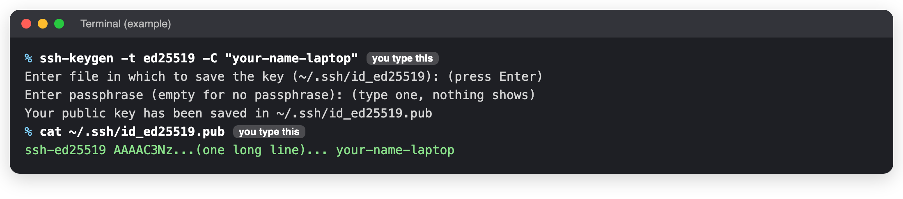
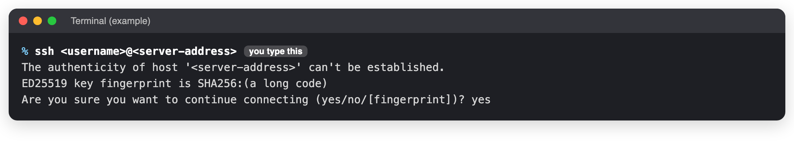
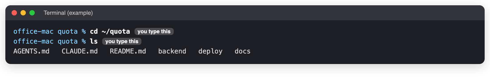

# Connect to the server

**When to use this:** A page says "on the office Mac", and you are not sitting at it.
**Time it takes:** 5 minutes (the first time: 15)
**You need:** Your own computer, to be in the office (or on the office VPN), and the server address and your
username from the person who manages the server.

If you **are** sitting at the office Mac, skip to [Go to the Quota folder](#go-to-the-quota-folder).

!!! warning "The address and username are not on this site"
    This site is public. Ask the developer, or look in the team password manager. Below, replace
    `<username>` and `<server-address>` with what they give you.

## The first time only: make your key

A key is how the Mac knows it is you. You make it once on your own computer.

1. Open the **Terminal** on your own computer. On a Mac: **⌘ Space**, type `Terminal`, press **Return**.
   On Windows: open **PowerShell** from the Start menu.
2. Copy this, paste it, press **Return**:

    ```bash
    ssh-keygen -t ed25519 -C "your-name-laptop"
    ```

3. It asks where to save: press **Return**. It asks for a passphrase: type one you will remember, press
   **Return**, then type it again. Nothing shows while you type. That is normal.
4. Show your key:

    ```bash
    cat ~/.ssh/id_ed25519.pub
    ```

    

5. Copy the **whole** line that starts with `ssh-ed25519` and send it to the person who manages the server.
   Wait until they say it has been added.

!!! danger "Only ever send the line from the file ending in .pub"
    The other file, without `.pub`, is your private key. Never send it or paste it anywhere.

## Every time: connect

1. In the Terminal on your own computer:

    ```bash
    ssh <username>@<server-address>
    ```

2. **The first time only**, it asks *Are you sure you want to continue connecting?* Type `yes` and press **Return**.

    

3. Type your key's passphrase if it asks. You are now typing on the office Mac.

## Go to the Quota folder

Every command on this site is typed in the Quota folder.

```bash
cd ~/quota
ls
```



!!! success "You should see"
    `backend`, `deploy` and `docs` in the list. If you do, you are in the right place.

## When you are done

Type `exit` and press **Return**. The connection closes.

## If you see something else

| You see | Do this |
|---|---|
| `Connection timed out` | You are not in the office or on the VPN, or the Mac is off. |
| `Connection refused` | The address is wrong, or remote login is off on the Mac. Ask the developer. |
| `Permission denied (publickey)` | Your key was not added yet, or the username is wrong. |
| `REMOTE HOST IDENTIFICATION HAS CHANGED` | **Stop.** Do not type yes. Ask the developer. |
| `No such file or directory` after `cd ~/quota` | You are connected to the wrong machine or user. Ask the developer. |

## Stay safe

- Use only your own key. If your laptop is lost, tell the server manager at once so your key is removed.
- Do not run commands you do not understand. Never run `docker compose down -v` or `docker volume prune`.

_Last checked: 2026-11-11_
