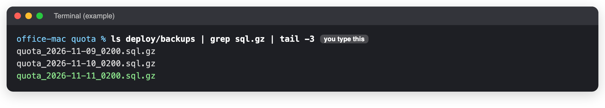
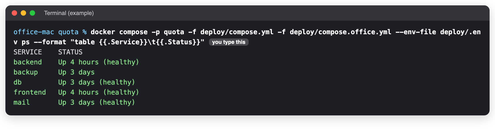

# Restore the database from a backup

**When to use this:** Data was lost or damaged, and the developer agreed to go back to a backup.
**Time it takes:** 20 minutes
**You need:** The Terminal on the office Mac ([connect](../connect.md) if you are not at it).

!!! danger "This replaces everything in the live database"
    Anything entered after the backup was taken is **lost**. Do this only when the developer agrees. Tell
    staff to stop using Quota first.

## Before you start

- [ ] The developer agreed.
- [ ] Staff were told to stop using Quota.
- [ ] You know which day to go back to.

## 1. Go to the Quota folder and find the backup

```bash
cd ~/quota
ls deploy/backups | grep sql.gz | tail -3
```



Pick the file of the day you want, for example `quota_2026-11-11_0200.sql.gz` (11 November, 02:00). After a
release there is also a `pre-update_...sql.gz` from just before it.

## 2. Stop everything that writes to the database

```bash
docker compose -p quota -f deploy/compose.yml -f deploy/compose.office.yml --env-file deploy/.env stop backend backup
```

## 3. Empty the database

```bash
docker compose -p quota -f deploy/compose.yml -f deploy/compose.office.yml --env-file deploy/.env exec -T db psql -U postgres -c 'DROP DATABASE quota' -c 'CREATE DATABASE quota'
```

!!! success "You should see"
    `DROP DATABASE` then `CREATE DATABASE`.

## 4. Load the backup

Change the file name to the one you picked in step 1, then run it:

```bash
gunzip -c deploy/backups/quota_2026-11-11_0200.sql.gz | docker compose -p quota -f deploy/compose.yml -f deploy/compose.office.yml --env-file deploy/.env exec -T db psql -U postgres quota
```

Many lines scroll past. That is normal. It takes a few minutes.

## 5. Start everything again

```bash
docker compose -p quota -f deploy/compose.yml -f deploy/compose.office.yml --env-file deploy/.env start backend backup
docker compose -p quota -f deploy/compose.yml -f deploy/compose.office.yml --env-file deploy/.env exec backend alembic upgrade head
```

## Check it worked

```bash
docker compose -p quota -f deploy/compose.yml -f deploy/compose.office.yml --env-file deploy/.env ps --format "table {{.Service}}\t{{.Status}}"
```



Then sign in, open a **recent** order and its offer. Tell staff the date and time the data goes back to, so they
can enter again anything newer.

## If you see something else

| You see | Do this |
|---|---|
| `database "quota" is being accessed by other users` | Step 2 did not stop everything. Do step 2 again, then step 3. |
| `gzip: not in gzip format` or `No such file` | The file name is wrong. Copy it again from step 1. |
| `service "db" is not running` | `docker compose -p quota -f deploy/compose.yml -f deploy/compose.office.yml --env-file deploy/.env up -d db`, wait a minute, then step 3 again. |
| Errors about missing columns after the restore | Do the second line of step 5 again. |

_Last checked: 2026-11-11_
