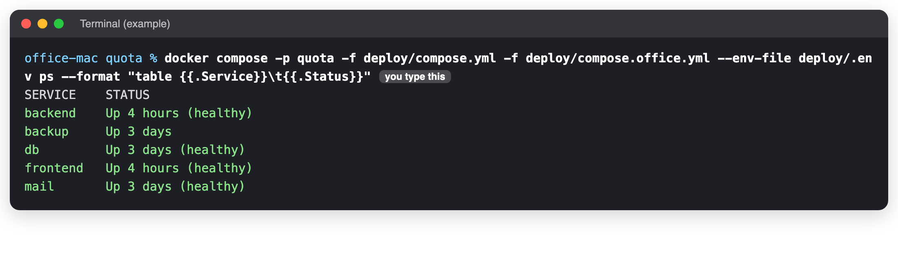
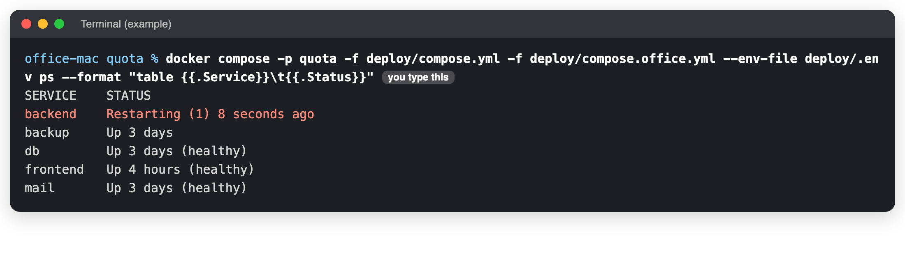
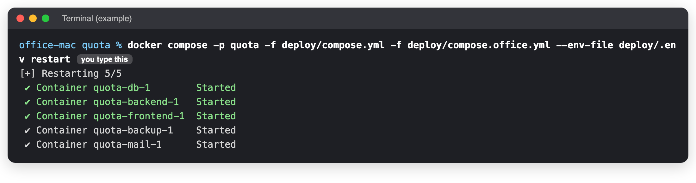
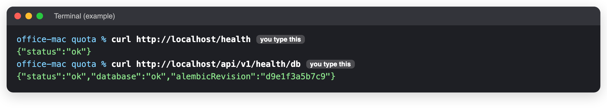

# The site is down: first five minutes

**When to use this:** Staff cannot open Quota, or every page shows errors.
**Time it takes:** 5 minutes to find the cause
**You need:** The Terminal on the office Mac ([connect](../connect.md) if you are not at it).

!!! tip "Stay calm, change one thing at a time"
    The data is safe in the database. Most problems are fixed by a restart. Do **not** delete anything.

## 1. Is it Quota, or the way in?

Ask someone in the office to open Quota **on the office network**. If it works there but not from home, the
problem is the tunnel, not Quota: go to [How staff and clients reach it](../reach.md).

## 2. Go to the Quota folder

```bash
cd ~/quota
```

If this says `No such file or directory`, you are not on the office Mac. See [Connect to the server](../connect.md).

## 3. Which box is in trouble?

```bash
docker compose -p quota -f deploy/compose.yml -f deploy/compose.office.yml --env-file deploy/.env ps --format "table {{.Service}}\t{{.Status}}"
```



A box in trouble says **Restarting**, **Exited** or **unhealthy**, or is missing from the list:



## 4. Match what you see

| You see | What it means | Do this |
|---|---|---|
| `Cannot connect to the Docker daemon` | OrbStack, the app that runs the boxes, is closed | [The office Mac](../maintenance/office-mac.md) |
| Every box says **Up**, but the site does not load | The boxes are fine; it is the way in | [How staff and clients reach it](../reach.md) |
| `db` is not running | The database stopped | Do step 5. Check the disk with `df -h /`. If it will not start: [Restore](restore-database.md) |
| `backend` keeps restarting | Often the database is down, or a setting is wrong | Do step 5, then read its messages (step 6) |
| Pages load, but actions give **502** | The website cannot reach the backend | Do step 5 |
| Staff see a plain **403** page | A test server took Quota's port | Tell the developer. Do not stop the live boxes. |
| One feature fails: a PDF, an e-mail, a picture | Not the whole site | [Common errors](common-errors.md) |
| It broke right after a release | The new version | [Go back to an earlier version](../deploy/rollback.md) |
| The Mac does not answer at all | Off, or the network is down | [The server is gone](server-lost.md) |

## 5. Restart (keeps all data)

```bash
docker compose -p quota -f deploy/compose.yml -f deploy/compose.office.yml --env-file deploy/.env restart
```



Wait one minute, then do step 3 again. If a box is still in trouble, stop it all and start it again:

```bash
docker compose -p quota -f deploy/compose.yml -f deploy/compose.office.yml --env-file deploy/.env down
docker compose -p quota -f deploy/compose.yml -f deploy/compose.office.yml --env-file deploy/.env up -d
```

!!! danger "Never add -v to down"
    `down -v` erases the database.

## 6. Still broken? Read the messages

```bash
docker compose -p quota -f deploy/compose.yml -f deploy/compose.office.yml --env-file deploy/.env logs --tail=100 backend
```

Copy the last 30 lines and send them to the developer.

## Check it worked

```bash
curl http://localhost/health
curl http://localhost/api/v1/health/db
```



Then sign in and open an order.

## After it is fixed

- Write down what happened, what you did, and the times.
- Tell the team it is back.

_Last checked: 2026-11-11_
