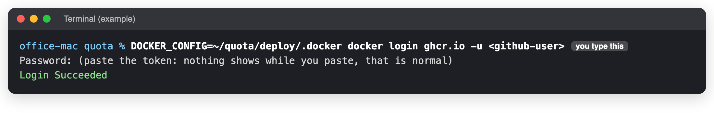
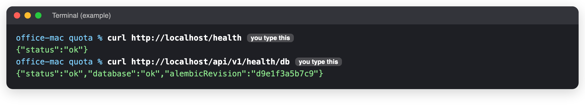

# First install

**When to use this:** Setting up Quota Dashboard on a new machine, or after [the server is gone](../crashes/server-lost.md).
**Time it takes:** 45 minutes
**You need:** A Mac with OrbStack (or Linux with Docker and the compose plugin), about 3 GB of disk, a GitHub token with only **read:packages**, the saved `deploy/.env` from the password manager, and the pictures folder (`images/`) on the machine.

!!! note "A job for the developer"
    This page is for setting up a whole new machine. Follow it with the developer on the phone if you can.

The machine does not build anything: it downloads the versions the robots built and tested.

## Before you start

- [ ] On a Mac, set it up as [The office Mac](../maintenance/office-mac.md) describes first.
- [ ] Keep the Quota folder outside Documents, Desktop and Downloads (macOS blocks background jobs there). `~/quota` is right.

## Steps

1. **Get the deploy folder.**

   ```bash
   git clone git@github.com:AbuEnzo/quota-dashboard-backend.git ~/quota
   cd ~/quota/deploy
   ```

2. **Let the machine download the versions.** Quota keeps its own GitHub sign-in in this folder:

   ```bash
   mkdir -p .docker
   DOCKER_CONFIG=$PWD/.docker docker login ghcr.io -u <github-user>
   ```

   Paste the read-only token when it asks for the password. Nothing shows while you paste.

    

3. **The settings file.** Copy back the saved one. Only for a brand-new install, start from the example instead
   and fill in every value (`nano .env`):

   ```bash
   cp .env.example .env      # brand-new install only
   ```

   On the office Mac it must contain `QUOTA_COMPOSE_EXTRA=compose.office.yml`.

4. **First start.** The same script that updates: it downloads, creates the database tables and starts everything.

   ```bash
   ./update.sh
   ```

5. **Brand-new install only: the catalogue and the first administrator.** Choose a strong password in place of `choose-one`.

   ```bash
   cd ~/quota
   docker compose -p quota -f deploy/compose.yml -f deploy/compose.office.yml --env-file deploy/.env exec backend python scripts/import_legacy.py
   docker compose -p quota -f deploy/compose.yml -f deploy/compose.office.yml --env-file deploy/.env exec -e SEED_ADMIN_PASSWORD='choose-one' backend python scripts/seed_admin.py admin@example.com "Administrator"
   ```

   When moving to a new machine, [restore the database](../crashes/restore-database.md) instead.

6. **Turn on the schedules** (updates, backups, the weekly test):

   ```bash
   cd ~/quota/deploy && ./install-macos.sh
   ```

7. **Start the tunnels** so staff and clients can reach it. See [How staff and clients reach it](../reach.md).

## Check it worked

```bash
curl http://localhost/health
curl http://localhost/api/v1/health/db
```



Then open `https://quota.selectdmc.com` and sign in.

## If something goes wrong

| You see | Do this |
|---|---|
| `unauthorized` while downloading | Step 2 again; the token needs **read:packages**. |
| `set POSTGRES_PASSWORD in deploy/.env` | The settings file is missing a value. Edit `deploy/.env`. |
| `set MEDIA_ROOT in deploy/.env` | Point it at the pictures folder. |
| `network quota-net not found` | Create it once: `docker network create quota-net`, then step 4 again. |
| Import cannot reach the legacy database | The old database address is wrong or not reachable from the container. Ask the developer. |
| Anything else | [Site is down](../crashes/site-down.md) |

_Last checked: 2026-11-11_
