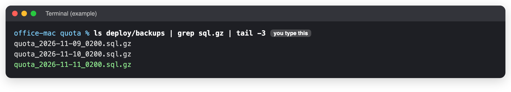
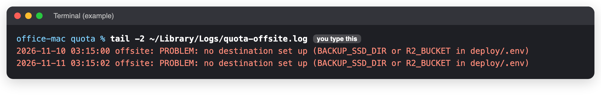

# Backups

**When to use this:** To know where the copies are, and to check they are being made.
**Time it takes:** 5 minutes
**You need:** The Terminal on the office Mac ([connect](../connect.md) if you are not at it).

!!! danger "Not finished: only one copy exists today"
    As of 11 November 2026 the **backup SSD** and the **online copy (Cloudflare R2)** are not set up, and
    neither are the warning e-mails. So every copy stays on the office Mac, the 03:15 job fails every night
    with "no destination", and **nobody is told** if something goes wrong. If the Mac is lost, the data is lost.
    Until this is done, check by hand every week (below). The steps to set them up are in `deploy/README.md`
    in the Quota repository, under "Backup and restore" and "Monitoring".

## What is automatic

| When | What | Where |
|---|---|---|
| Every night, 02:00 | The database (about 130 MB) and Quota's own files (offer PDFs, mail attachments) | On the Mac, in `~/quota/deploy/backups` (30 days of database copies, 7 of files) |
| Before every release | The database | Same folder, named `pre-update_...` |
| Every night, 03:15 | Everything above, plus the offer pictures | The backup SSD and Cloudflare R2, **once set up** |
| Every Sunday | A test: the newest copy is loaded into a scratch database and checked | Nothing kept |

## Check it by hand

### 1. Last night's copy exists

```bash
cd ~/quota
ls deploy/backups | grep sql.gz | tail -3
```



!!! success "You should see"
    The last line has **today's date**, for example `quota_2026-11-11_0200.sql.gz`.

### 2. The copy off the Mac

```bash
tail -2 ~/Library/Logs/quota-offsite.log
```

Today it says **PROBLEM: no destination set up**. That is the unfinished part above:



Once the SSD or R2 is set up, the lines say `SSD: done` and `R2: done`.

## Take a copy by hand

Before anything risky, in the Quota folder:

```bash
docker compose -p quota -f deploy/compose.yml -f deploy/compose.office.yml --env-file deploy/.env exec -T db pg_dump -U postgres quota | gzip > deploy/backups/quota_manual.sql.gz
```

It takes about a minute and prints nothing when it works.

!!! danger "Keep these two safe, outside the Mac"
    The settings file `deploy/.env` and the backup encryption password are **not** in the backups. Keep both in
    the password manager. Without them the mailboxes cannot be opened and the online copy cannot be read.

## If you see something else

| You see | Do this |
|---|---|
| No file with today's date | The nightly backup stopped. Check the `backup` box: [Daily health check](health-checks.md), step 2. |
| "SSD is not there (drive unplugged?)" | Plug the SSD back in. It is checked again the next night. |
| "only N GB free" on the SSD | Tell the developer. |
| "R2: copying ... failed" | Internet down that night, or the R2 key expired. Tell the developer if it repeats. |

_Last checked: 2026-11-11_
