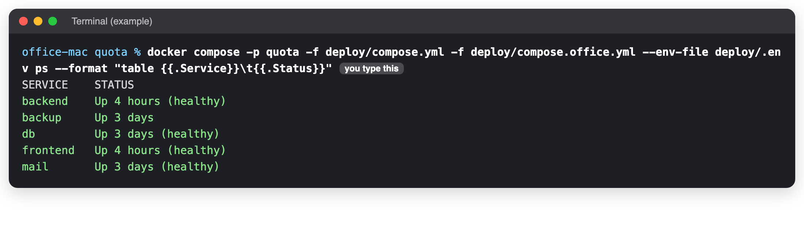
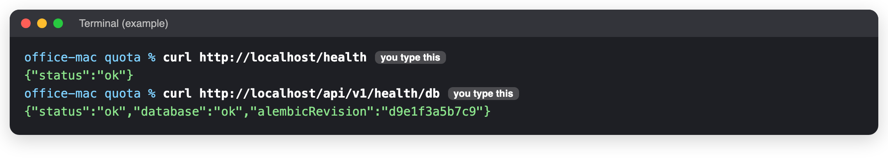
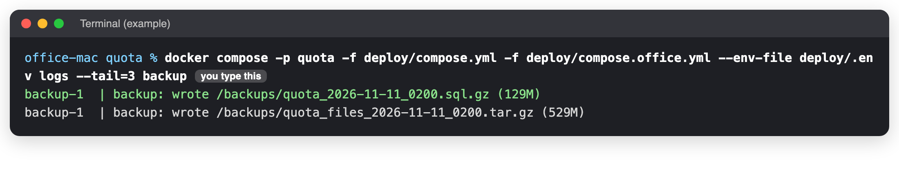
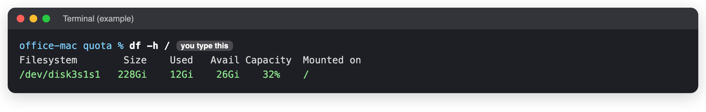

# Daily health check

**When to use this:** Every morning, or whenever you want to be sure Quota is OK.
**Time it takes:** 1 minute for the quick check, 5 minutes for the full one
**You need:** A browser. For the full check: the Terminal on the office Mac ([connect](../connect.md) if you are not at it).

## Quick check (no Terminal)

1. Open `https://quota.selectdmc.com` and sign in.
2. Open a recent order, then its offer.

!!! success "You should see"
    The order and the offer open normally. If they do, Quota is fine and you can stop here.

## Full check (on the office Mac)

### 1. Go to the Quota folder

```bash
cd ~/quota
```

### 2. Are all the boxes running?

```bash
docker compose -p quota -f deploy/compose.yml -f deploy/compose.office.yml --env-file deploy/.env ps --format "table {{.Service}}\t{{.Status}}"
```



!!! success "You should see"
    Five lines: `backend`, `backup`, `db`, `frontend` and `mail`, each saying **Up**. The hours and days will differ.

### 3. Does Quota answer?

```bash
curl http://localhost/health
curl http://localhost/api/v1/health/db
```



!!! success "You should see"
    `{"status":"ok"}`, then a line with `"database":"ok"`.

### 4. Was last night's backup made?

```bash
docker compose -p quota -f deploy/compose.yml -f deploy/compose.office.yml --env-file deploy/.env logs --tail=3 backup
```



!!! success "You should see"
    A line `backup: wrote /backups/quota_<today's date>_0200.sql.gz`. The date must be **today's** (it runs at 02:00).

### 5. Is there enough disk space?

```bash
df -h /
```



!!! success "You should see"
    More than **20Gi** under **Avail**. Below that, tell the developer this week. Below 10Gi, tell them today:
    a full disk stops the database.

## If you see something else

| You see | Do this |
|---|---|
| The quick check fails | [The site is down](../crashes/site-down.md) |
| A box says `Restarting`, `Exited`, or is missing | [The site is down](../crashes/site-down.md) |
| `curl` says `Connection refused` | [The site is down](../crashes/site-down.md) |
| No backup line with today's date, or `pg_dump failed` | Check the disk (step 5), then tell the developer. |
| Less than 20Gi free | Tell the developer. Never delete Docker volumes to make room. |

_Last checked: 2026-11-11_
