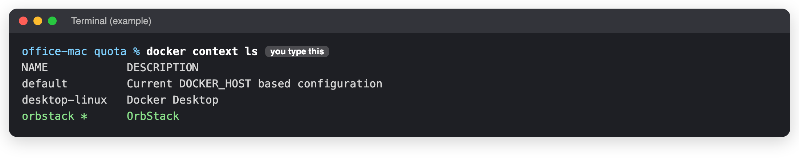
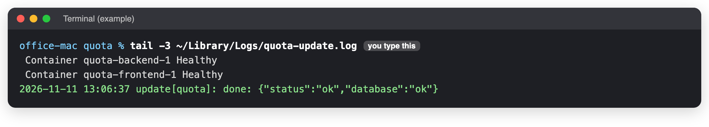
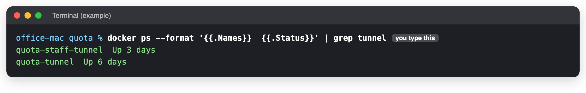
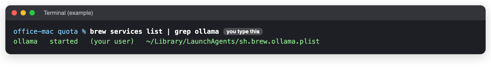
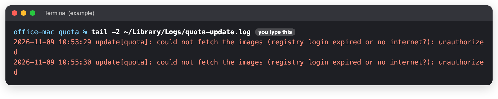
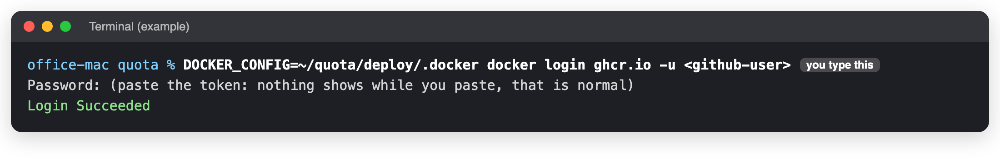

# The office Mac

**When to use this:** The Mac was restarted or updated, someone installed something on it, or a new version
did not arrive after a release.
**Time it takes:** 10 minutes
**You need:** A seat at the Mac, or the Terminal on it ([connect](../connect.md)).

Quota runs on the Mac mini in the office, from the folder `~/quota`. **Never run it from any other folder.**

## What must always be true

| What | Why |
|---|---|
| **OrbStack** is open, and set to *Start at login* | It runs every Quota box and both tunnels. They come back by themselves when it starts. |
| A user is logged in, and the Mac never sleeps | The update and backup jobs run only while someone is logged in. |
| The Mac starts by itself after a power cut | So Quota comes back with nobody in the office. |
| **Ollama** is running | The mailbox search by meaning uses it. |
| **Docker Desktop is not used** | If it is opened, it takes over and stops the boxes and the updates (this happened on 9 November 2026). |

## Check it: 4 steps

### 1. OrbStack is in charge

```bash
docker context ls
```



!!! success "You should see"
    A **star** `*` next to `orbstack`. If the star is somewhere else, type `docker context use orbstack` and press **Return**.

### 2. New versions arrive

```bash
tail -3 ~/Library/Logs/quota-update.log
```



!!! success "You should see"
    The last line says `done:`. If it says **unauthorized**, do [Quota's GitHub sign-in](#quotas-github-sign-in) below.

### 3. The tunnels are up

```bash
docker ps --format '{{.Names}}  {{.Status}}' | grep tunnel
```



!!! success "You should see"
    `quota-staff-tunnel` and `quota-tunnel`, both **Up**. If one is missing: `docker start quota-staff-tunnel quota-tunnel`.

### 4. The search helper runs

```bash
brew services list | grep ollama
```



!!! success "You should see"
    `ollama  started`. If it says anything else: `brew services restart ollama`.

## Quota's GitHub sign-in

The Mac downloads every new version from GitHub, signed in with a read-only key (a "token"). If the update log
says **unauthorized**, the sign-in is gone or the token expired.



1. Ask the developer for a new GitHub token with only **read:packages** (or make one on GitHub: your picture,
   top right → **Settings** → **Developer settings** → **Personal access tokens** → **Tokens (classic)** →
   **Generate new token**, tick only **read:packages**).
2. On the office Mac, type this (change `<github-user>` to the GitHub username):

    ```bash
    DOCKER_CONFIG=~/quota/deploy/.docker docker login ghcr.io -u <github-user>
    ```

3. When it asks for **Password**, paste the token and press **Return**. Nothing shows while you paste. That is normal.

    

4. Within 2 minutes the Mac installs whatever was released. Check with step 2 above.

!!! danger "The token is a password"
    Never put it in chat, e-mail or on this site.

## The automatic jobs

| Job | When | Its log in `~/Library/Logs/` |
|---|---|---|
| Install a released version | Every 2 minutes | `quota-update.log` |
| Copy backups off the Mac | Every night at 03:15 | `quota-offsite.log` |
| Prove the backups can be restored | Every Sunday | `quota-restore.log` (appears after the first Sunday) |

To see them: `launchctl list | grep quota`. To put them back after a reinstall: `cd ~/quota/deploy && ./install-macos.sh`.

## If you see something else

| You see | Do this |
|---|---|
| "I pressed Release but nothing changed" | Step 2. `unauthorized`: the sign-in above. `FAILED ... rolled back`: the new version was refused; tell the developer. |
| `Cannot connect to the Docker daemon` | Open **OrbStack** from Applications. Wait a minute. Then step 1. |
| After a power cut nothing came back | Someone must log in at the Mac once. Then check OrbStack is open. |
| Mail search finds words but not meanings | Step 4. |

_Last checked: 2026-11-11_
